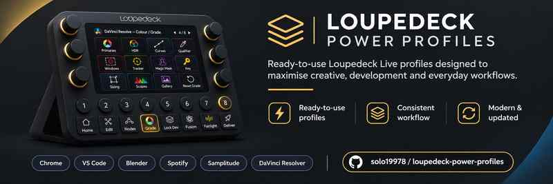

# Loupedeck Power Profiles

**Powerful, ready-to-use Loupedeck Live profiles built to help you get more out of your hardware and spend less time rebuilding workflows from scratch.**

## Why I created this

I built **Loupedeck Power Profiles** because I wanted my Loupedeck Live to do more than simply trigger a few shortcuts.

The goal was to turn it into a proper workflow controller across the applications I actually use — while keeping the controls familiar from one program to the next.

A lot of Loupedeck profiles, downloads and community resources that have existed over the years are now difficult to find, outdated, no longer maintained, or built around older versions of the software they control. Rather than relying on profiles that may disappear or rebuilding the same setup every time, I started creating my own collection and keeping it together in one place.

These profiles are designed around current **2026-era Loupedeck software and workflows**, with layouts, shortcuts, macros, dial controls and visual icons organised for practical everyday use.

## The idea behind the profiles

The main principle is simple:

> **You should not have to relearn your controller every time you open a different application.**

Where it makes sense, the same core actions stay in familiar positions across profiles.

Things such as:

- Undo / Redo
- Save
- Play / Pause
- Delete
- Split / Cut
- Navigation
- Zoom
- Search
- Timeline movement
- Frequently used tools

are kept predictable.

Each profile then adds the deeper controls that make sense for that particular application.

For example, a DaVinci Resolve profile can go much deeper into nodes, colour grading, Fusion, Fairlight and delivery, while a Blender profile focuses on modelling, VFX tracking, sculpting, geometry nodes, UV work and rendering.

The aim is to reduce mouse movement, menu hunting and unnecessary keyboard combinations while still keeping the software understandable.

## What makes these different

These are not intended to be giant collections of random shortcuts.

The profiles are designed around complete workflows:

- **Multiple organised pages** instead of one overloaded screen
- **Useful dial mappings** where rotary control makes sense
- **Consistent muscle memory** between applications
- **Real visual button icons** where supported
- **Application-specific tools and macros**
- **Practical layouts for Loupedeck Live**
- **Modernised profile structures for current Loupedeck software**
- **Profiles that can continue to be refined as applications change**

## Profiles in the collection

The collection is being built around applications including:

- Google Chrome
- Visual Studio Code
- Blender
- Spotify
- Samplitude Suite
- DaVinci Resolve

More profiles and revisions can be added over time.

## Loupedeck in the Logitech era

Logitech acquired Loupedeck in 2023.

In 2025, Loupedeck announced that direct sales of the Loupedeck product line would end while support would continue, with future software updates and plug-ins able to benefit Loupedeck owners through the shared platform used by the Logitech MX Creative Console ecosystem.

That transition is another reason I wanted to keep a maintained collection of useful Loupedeck Live profiles available in one place.

The hardware is still extremely capable. These profiles are about continuing to get as much value as possible from it.

## Profiles available now

The current downloadable Loupedeck Live profiles are organised by application:

| Application | Profile |
| --- | --- |
| Google Chrome | [Loupedeck Power Profiles — Chrome](profiles/chrome/loupedeck-power-profiles-chrome.lp5) |
| Visual Studio Code | [Loupedeck Power Profiles — VS Code](profiles/vscode/loupedeck-power-profiles-vscode.lp5) |
| Blender | [Loupedeck Power Profiles — Blender](profiles/blender/loupedeck-power-profiles-blender.lp5) |
| Spotify | [Loupedeck Power Profiles — Spotify](profiles/spotify/loupedeck-power-profiles-spotify.lp5) |
| Samplitude Suite 2025 | [Loupedeck Power Profiles — Samplitude](profiles/samplitude/loupedeck-power-profiles-samplitude.lp5) |
| DaVinci Resolve | [Loupedeck Power Profiles — DaVinci Resolve](profiles/davinci-resolve/loupedeck-power-profiles-davinci-resolve.lp5) |

Click a profile above, then use **Download raw file** / **Raw** from GitHub to save the `.lp5` file before importing it into Loupedeck.

## Compatibility

These profiles are primarily created for the **Loupedeck Live**.

They are built and maintained around the current software environment used during 2026. Individual applications, plug-ins and keyboard mappings can change over time, so some actions may require adjustment depending on your application version, operating system or personal shortcut configuration.

Where possible, profiles preserve the application's actual Loupedeck binding rather than relying only on generic executable detection.

## Installation

Profile files will be provided in Loupedeck's importable **`.lp5`** format.

Typical installation:

1. Download the profile you want.
2. Open the Loupedeck software.
3. Open the profile menu.
4. Choose **Import Profile**.
5. Select the downloaded `.lp5` file.
6. Check the application binding and test the controls in your setup.

## Project status

This repository is a living collection.

Profiles may be updated when:

- application shortcuts change;
- new useful controls are found;
- layouts can be simplified;
- better icons become available;
- Loupedeck / Logitech software changes;
- a workflow can be made faster or easier to learn.

## Disclaimer

This is an independent community project and is **not affiliated with, endorsed by, or sponsored by Logitech, Loupedeck, Blackmagic Design, Adobe, MAGIX, Blender Foundation, Microsoft, Google, Spotify, or any other software vendor referenced in the profiles**.

Product names and trademarks belong to their respective owners.

---

### Loupedeck Power Profiles

**Built to maximise your workflow, not make you learn your controller again.**
